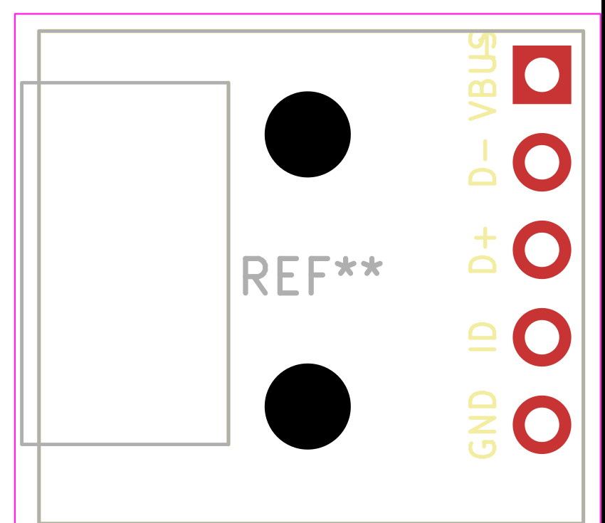

# KiCad USB Micro-B Breakout Library

KiCad V6+ symbol and footprint for the common **female USB Micro-B breakout board** — the small green PCB with a Micro-B socket on one edge and a 5-pin 0.1″ header on the other. It breaks out **VBUS, D−, D+, ID and GND** for breadboards and carrier boards.

This library models the complete breakout module, not the bare USB connector. For a bare Micro-B receptacle, use KiCad’s `Connector:USB_B_Micro` symbol with a matching `Connector_USB` footprint.



---

## What’s included

```
USB_MicroB_Breakout.kicad_sym          — Symbol (VBUS, D−, D+, ID, GND)
USB_MicroB_Breakout.pretty/
└── USB_MicroB_Breakout.kicad_mod      — Module footprint
```

---

## The module this targets

| Property | Value |
|---|---|
| Connector | USB Micro-B female, SMD |
| Header | 1×5, 2.54 mm |
| Pin order | VBUS, D−, D+, ID, GND |
| Board size | 15.8 × 14.3 × 4 mm |
| Mounting holes | 2× 2.5 mm |
| Header pins | Male pin headers sold separately |

The pin order is the one printed on the board: **VBUS — D− — D+ — ID — GND**, with VBUS at the top.

---

## Pinout

| Symbol pin | Board label | Type | Notes |
|---:|---|---|---|
| 1 | VBUS | Power out | 5 V from USB |
| 2 | D− | Bidirectional | USB data |
| 3 | D+ | Bidirectional | USB data |
| 4 | ID | Passive | Usually unconnected |
| 5 | GND | Power out | Ground |

Pin 1 is the square pad.

---

## Installation

### 1. Clone or download

```bash
git clone https://github.com/V01Ddev/kicad-usb-microb-breakout-library.git
```

Or download the ZIP from the green **Code** button above.

### 2. Add the symbol library

In KiCad: **Preferences > Manage Symbol Libraries > Add existing library**

Point it to:

```
/path/to/kicad-usb-microb-breakout-library/USB_MicroB_Breakout.kicad_sym
```

### 3. Add the footprint library

In KiCad: **Preferences > Manage Footprint Libraries > Add existing library**

Point it to the `.pretty` folder:

```
/path/to/kicad-usb-microb-breakout-library/USB_MicroB_Breakout.pretty
```

The assigned footprint is `USB_MicroB_Breakout:USB_MicroB_Breakout`.

---

## Footprint details

- Board outline 15.8 × 14.3 mm on `F.SilkS`, `F.Fab` and `F.CrtYd`
- 1×5 header at 2.54 mm pitch, 1.7 mm pad / 1.0 mm drill
- 2× 2.5 mm non-plated mounting holes
- Pin 1 square pad; silkscreen labels VBUS, D−, D+, ID, GND
- USB socket body outline on `F.Fab`; courtyard includes the socket overhang

Positions measured from the board’s top-left corner:

| Feature | Position |
|---|---|
| Header pads | X = 14.6 mm; Y = 1.27 / 3.81 / 6.35 / 8.89 / 11.43 mm |
| Mounting holes | (7.8, 3.0) mm and (7.8, 10.9) mm |

The footprint represents the module’s own header pads. On a carrier board, use a matching 1×5 female header or solder the module pins directly.

---

## Verification

The 15.8 × 14.3 × 4 mm board size is from the Electrokit product page. The header X position and the two mounting-hole positions were measured from the product photo and are estimates. Measure your board with calipers before ordering a PCB.

---

## Tested with

- KiCad 10 on Arch Linux
- Electrokit “USB micro monterad på kort” (SKU 4101 6787)
- Generic 15.8 × 14.3 mm female Micro-B breakout boards with the same 5-pin layout

---

## Source module

[Electrokit — USB micro monterad på kort](https://www.electrokit.com/en/usb-micro-monterad-pa-kort)

---

## License

[CC BY-NC-SA 4.0](https://creativecommons.org/licenses/by-nc-sa/4.0/) — Attribution-NonCommercial-ShareAlike 4.0 International.

This library is an original work by [v01d.dev](https://github.com/V01Ddev), distributed under the same license as the other KiCad libraries in this account.
